# ownWiki

Ein selbst gehostetes Wiki für technische Dokumentation und Anleitungen – mit einem PDF-Export, der genau so aussieht wie die Seite im Browser.

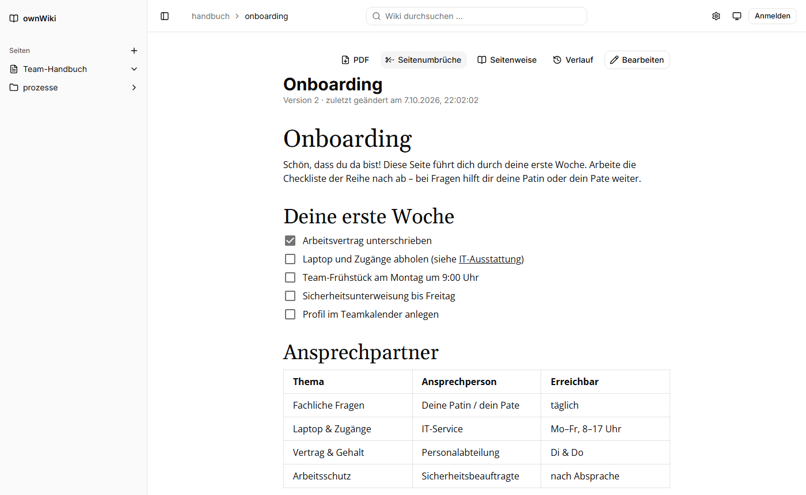

## Funktionen

- **WYSIWYG-Editor auf Markdown-Basis** ([Milkdown Crepe](https://milkdown.dev)): Überschriften, Listen, Checklisten, Tabellen, Code mit Syntax-Hervorhebung, Formeln, Bilder.
- **Titel aus der ersten Zeile**: Die Überschrift in der ersten Zeile einer Seite ist ihr Titel – ein eigenes Titelfeld gibt es nicht. Seiten ohne Überschrift oben behalten ihren bisherigen Titel.
- **PDF-Export, der dem Bildschirm entspricht** – einzelne Seiten, ganze Bereiche mit Unterseiten oder das komplette Wiki.
- **Seitenumbruch-Vorschau**: Schon beim Schreiben zeigt eine Linie, wo im PDF eine neue Seite beginnt.
- **Diagramme direkt im Text**: Mermaid, BPMN (bpmn-js) und Excalidraw.
- **Dateien im Text**: hochladen und als Download-Link an der passenden Stelle einfügen.
- **Volltextsuche** über Titel, Pfade und Text aller Seiten, mit hervorgehobenen Treffern.
- **Versionsverlauf**: Jede Änderung wird gespeichert; alte Stände lassen sich ansehen und wiederherstellen.
- **Wiki-Links** im Obsidian-Stil: `[[Seitenname]]` oder `[[Seitenname|Linktext]]` – unter jeder Seite steht, welche Seiten auf sie verlinken (Backlinks).
- **Tags** an Seiten, mit Übersicht unter `/tags`.
- **Inbox** pro Person für schnelle Notizen, die später in eine Seite einsortiert werden.
- **Seitenhierarchie** über Pfade (`personal/kuendigung`), als einklappbare Seitenleiste.
- **Inhaltsverzeichnis** der geöffneten Seite rechts neben dem Text.
- **Anpassbare Werkzeugleiste**, **Hell- und Dunkelmodus**, **drei Zugriffsmodi** – vom offenen Team-Wiki bis zum privaten Wiki –, dazu **Rechte pro Bereich** für Gruppen und einzelne Personen.
- **SQLite oder PostgreSQL**, komplett in Docker betreibbar.

### Inhaltsverzeichnis

Rechts neben dem Text listet „Auf dieser Seite“ die Überschriften der geöffneten Seite, nach Ebenen eingerückt, und bleibt beim Scrollen sichtbar. Ein Klick springt zur Überschrift; der Abschnitt, in dem man gerade liest, ist markiert. Beim Bearbeiten aktualisiert sich das Verzeichnis sofort mit. Es erscheint, sobald neben der Textspalte genug Platz ist (Inhaltsbereich ab 1360 px, z. B. Full HD mit geöffneter Seitenleiste).

### Schreiben

Formatiert wird über die Werkzeugleiste, über Markdown-Kürzel (`## `, `- `, `**fett**` …) oder über das **„/“-Menü**: In einer leeren Zeile `/` tippen.

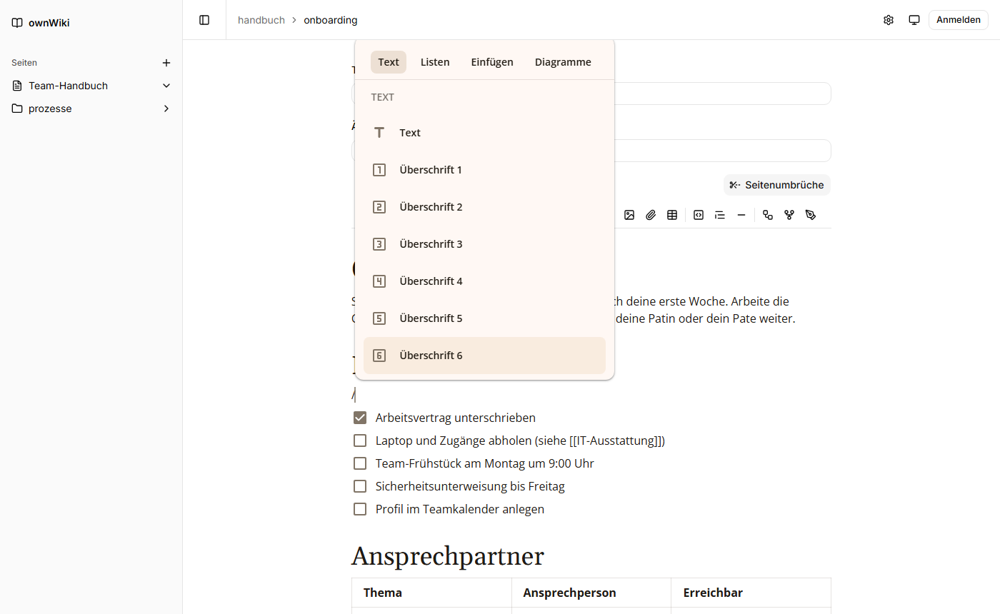

Welche Werkzeuge in der Leiste stehen und in welcher Reihenfolge, stellt jede Person unter **Einstellungen** (Zahnrad oben rechts) selbst ein. Mit Konto wird das im Konto gespeichert, sonst im Browser.

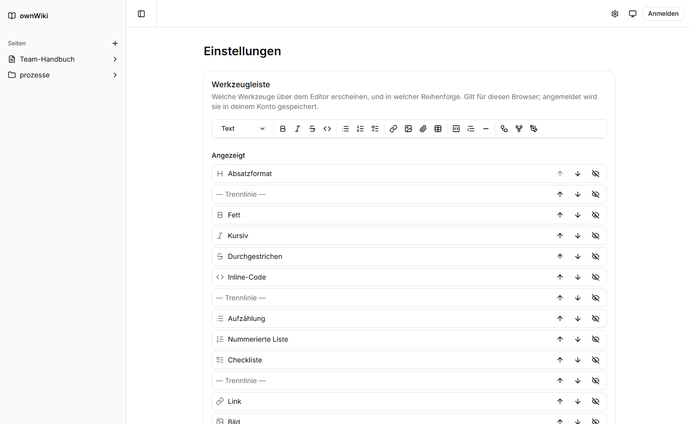

### PDF-Export

„PDF“ auf einer Seite öffnet die Export-Einstellungen: mit Unterseiten (der ganze Bereich), mit Inhaltsverzeichnis und mit eigener Titelseite. „Ganzes Wiki als PDF“ auf der Startseite exportiert alles inklusive Deckblatt. Die Knöpfe einer Seite (PDF, Seitenumbrüche, Verlauf, Bearbeiten) stehen links neben dem Text, in schmalen Fenstern über dem Text.

Die **Titelseite** gestaltest du direkt im Export-Fenster auf einem A4-Blatt – mit dem normalen Editor: Überschrift, Text, Logo oder andere Bilder (Größe an der Ecke ziehen), alles wie auf einer Wiki-Seite. Das Blatt zeigt Ränder und Proportionen wie im PDF; der Inhalt lässt sich waagerecht (links/mittig) und senkrecht (oben/mittig/unten) ausrichten, z. B. für ein Logo in der Seitenmitte. „Ganze Seite“ zeigt das Blatt komplett, „100 %“ in Originalgröße. Passt der Inhalt nicht auf eine Seite, weist das Fenster darauf hin. Die Titelseite wird beim Export mit der Seite gespeichert und ist beim nächsten Mal wieder da; im PDF ersetzt sie das automatische Deckblatt als Seite 1. Ist „Eigene Titelseite“ aus, bleibt das Blatt ausgegraut sichtbar.

Das PDF wird nicht nachgebaut, sondern aus der echten Seite erzeugt: dieselbe Textbreite (A4 mit Rändern), dieselben eingebetteten Schriften, derselbe Editor. Zeilen brechen deshalb an exakt denselben Stellen um. Tabellen und lange Codeblöcke werden zeilenweise auf mehrere Seiten verteilt, der Tabellenkopf wiederholt sich auf jeder Seite.

Jedes PDF hat Lesezeichen für die Seitenleiste des PDF-Betrachters: jede Wiki-Seite mit ihren Abschnitten darunter. Mit dem Haken „Inhaltsverzeichnis“ (im Export-Fenster bzw. auf der Startseite) folgt auf das Deckblatt bzw. die Titelseite außerdem eine gedruckte Inhaltsseite mit Seitenzahlen – Seiten und ihre Überschriften der ersten beiden Ebenen, im PDF anklickbar. Einzelne Seiten bekommen dafür ebenfalls ein Deckblatt, sodass das Verzeichnis immer auf Seite 2 steht. Der Browser merkt sich die Einstellung.

<p align="center">
  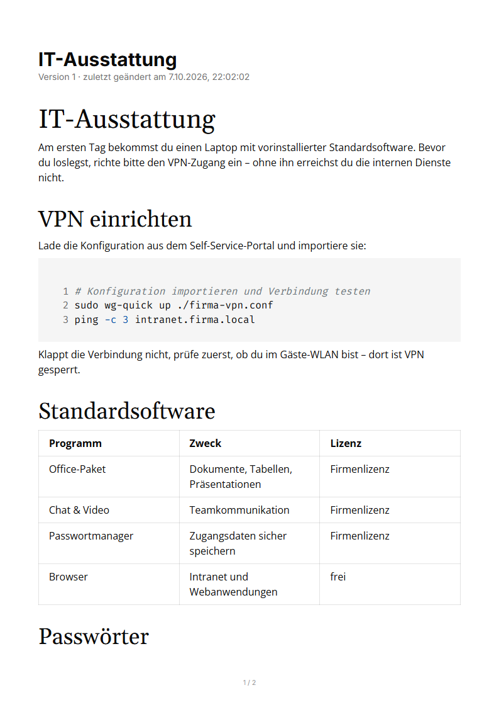
</p>

Damit man schon beim Schreiben sieht, wo eine Seite endet, markiert eine gestrichelte Linie jeden Seitenumbruch – auch mitten in einem Absatz, einer Tabelle oder einem Codeblock. Ein- und ausschalten lässt sie sich über „Seitenumbrüche“.

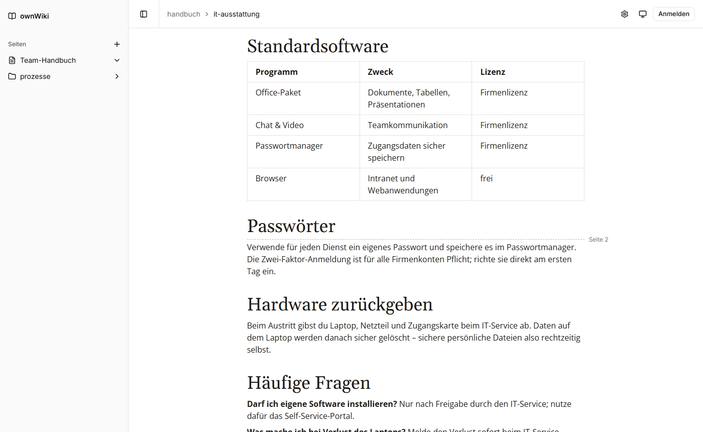

### Diagramme

Diagramme werden über das „/“-Menü (Gruppe „Diagramme“) oder die Werkzeugleiste eingefügt. Sie stehen als Codeblock im Markdown der Seite (` ```mermaid `, ` ```bpmn `, ` ```excalidraw `) – werden also mit der Seite versioniert und landen im PDF. Angezeigt wird die fertige Grafik:

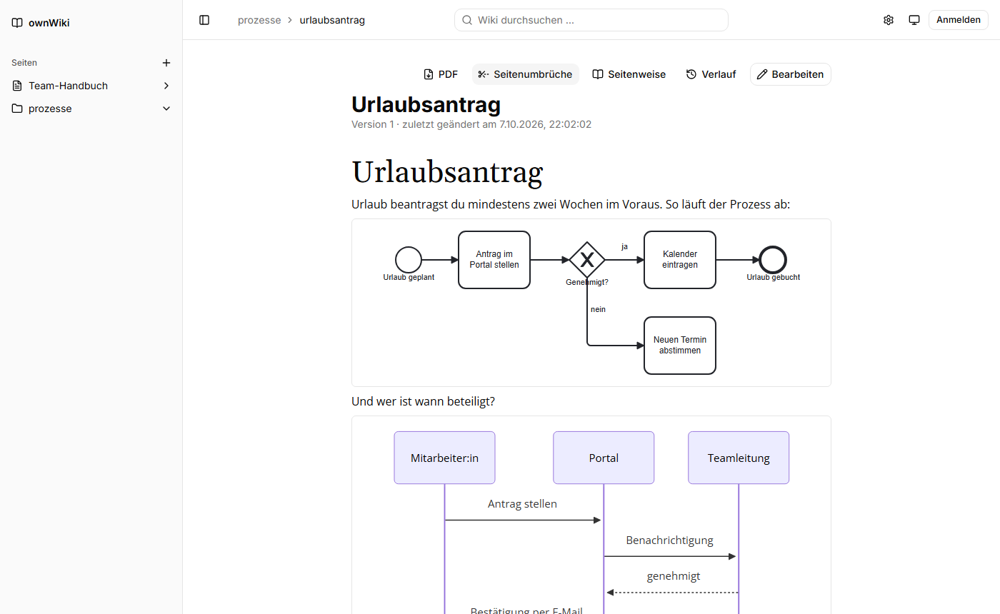

„Bearbeiten“ an einem Diagramm öffnet den passenden Editor groß im Dialog: Mermaid-Code mit Live-Vorschau, den bpmn-js-Modeler oder die Excalidraw-Zeichenfläche.

| BPMN                                                       | Excalidraw                                                             |
| ---------------------------------------------------------- | ---------------------------------------------------------------------- |
| 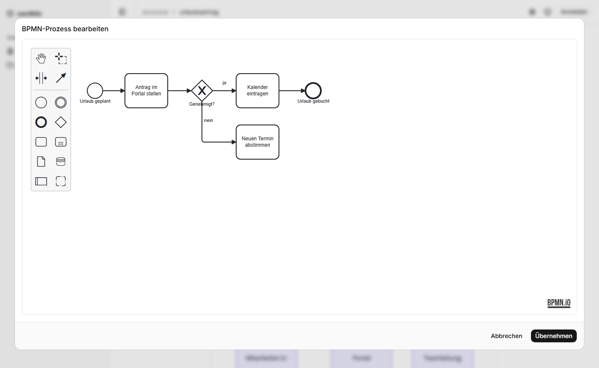 | 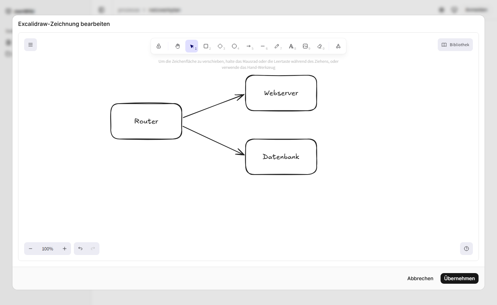 |

Alle Diagramm-Bibliotheken – auch die Schriften von Excalidraw – liefert der eigene Server aus; es werden keine externen Dienste angefragt. Geladen werden sie erst, wenn eine Seite sie braucht.

### Dateien

„Datei“ im „/“-Menü oder in der Werkzeugleiste lädt eine oder mehrere Dateien hoch (je bis 10 MB) und fügt sie als Download-Link an der Cursor-Stelle ein. Bilder, die im Text erscheinen sollen, fügst du über „Bild“ ein. Dateien, die im Text nicht (mehr) verlinkt sind, listet die Bearbeiten-Ansicht auf – zum erneuten Einfügen oder endgültigen Löschen.

### Suche

Das Suchfeld oben in der Mitte durchsucht Titel, Pfade und Text aller Seiten (Diagramm-Quelltexte nicht). Treffer sind nach Relevanz sortiert – Treffer im Titel zählen mehr –, die gefundenen Wörter sind im Textausschnitt markiert. Es müssen alle Suchwörter vorkommen; andere Formen eines Wortes werden mitgefunden („Kündigungen“ findet „Kündigung“).

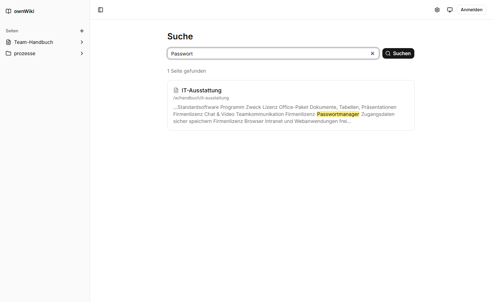

Unter SQLite sucht ownWiki mit FTS5, unter PostgreSQL mit der deutschen Volltextsuche der Datenbank (mit echter Wortstamm-Erkennung). Der Suchindex wird bei jedem Speichern aktualisiert und beim ersten Start automatisch aufgebaut.

**Semantische Suche (optional):** Mit einem Embedding-Dienst findet die Suche Seiten auch über ihre Bedeutung – „Datensicherung“ findet den Abschnitt „Backup“, die Frage „wie beantrage ich Urlaub?“ die Seite zum Urlaubsantrag. Solche Treffer stehen zwischen den Volltext-Treffern und sind als „inhaltlich ähnlich“ markiert; die KI-Anbindung sucht genauso. Dafür wird jede Seite in Abschnitte zerlegt, und der Dienst berechnet zu jedem einen Vektor (Embedding). Neue und geänderte Seiten kommen nach wenigen Sekunden dazu, bestehende beim ersten Start. Ist der Dienst nicht erreichbar, sucht ownWiki weiter mit der Volltextsuche.

Geeignet ist jeder Dienst mit der Embeddings-Schnittstelle von OpenAI (siehe `EMBEDDINGS_URL` unten), z. B.:

- **OpenAI:** `EMBEDDINGS_URL=https://api.openai.com/v1`, `EMBEDDINGS_MODEL=text-embedding-3-small` und ein API-Schlüssel. Kostet für ein ganzes Firmen-Wiki Cent-Beträge.
- **Azure OpenAI** (Daten in der EU): `EMBEDDINGS_URL=https://<ressource>.openai.azure.com/openai/v1`, als Modell der Name des Deployments.
- **Lokal mit [Ollama](https://ollama.com)**, ohne dass Text den Server verlässt und ohne Grafikkarte – am einfachsten mit dem mitgelieferten Container, siehe [Schnellstart](#schnellstart-mit-docker). Ohne Docker: `EMBEDDINGS_URL=http://localhost:11434/v1`, `EMBEDDINGS_MODEL=bge-m3` (vorher `ollama pull bge-m3`).

Lokal oder Cloud lässt sich jederzeit wechseln: Nach einem Modellwechsel erfasst ownWiki alle Seiten im Hintergrund neu, bis dahin sucht es mit der Volltextsuche.

Der Dienst bekommt den Text aller Seiten zu sehen, auch von Bereichen, die nur wenige lesen dürfen – sonst könnten diese Personen sie nicht finden. Wer was in den Ergebnissen sieht, regeln weiterhin die Rechte. Die Vektoren liegen in der eigenen Datenbank (Tabelle `page_search_chunk`); verglichen wird im Arbeitsspeicher, eine Datenbank-Erweiterung wie pgvector ist nicht nötig.

### Backlinks, Tags und Inbox

- **Backlinks:** Unter jeder Seite steht „Verlinkt von“ mit den Seiten, die per `[[Wiki-Link]]` oder `/w/…`-Link auf sie verweisen – soweit man sie lesen darf. Auch Links, die schon vor der Seite da waren, zählen, sobald es sie gibt.
- **Tags:** Unter dem Editor setzt man Tags, durch Kommas getrennt („hr, urlaub“). Sie stehen unter dem Seitentitel; das Tag-Symbol oben rechts führt zur Übersicht aller Tags und ihrer Seiten. Tags gehören nicht zum Versionsverlauf.
- **Inbox:** Über das Inbox-Symbol oben rechts (mit der Zahl offener Notizen) notiert man schnell etwas, das noch keinen Platz hat – nur man selbst sieht die eigene Inbox. Mit „Einsortieren“ landet eine Notiz in einer Seite: angehängt, wenn es die Seite gibt, sonst als neue Seite.

### Versionsverlauf

Jedes Speichern legt eine neue Version an. Im Verlauf lässt sich jede Version ansehen und wiederherstellen.

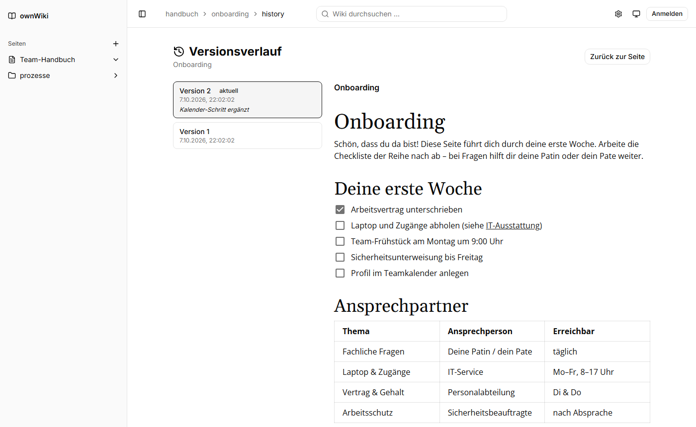

### Dunkelmodus

Über das Symbol oben rechts wählst du hell, dunkel oder die Systemeinstellung. Diagramme bleiben auf weißem Grund, damit sie genauso aussehen wie im (immer hellen) PDF.

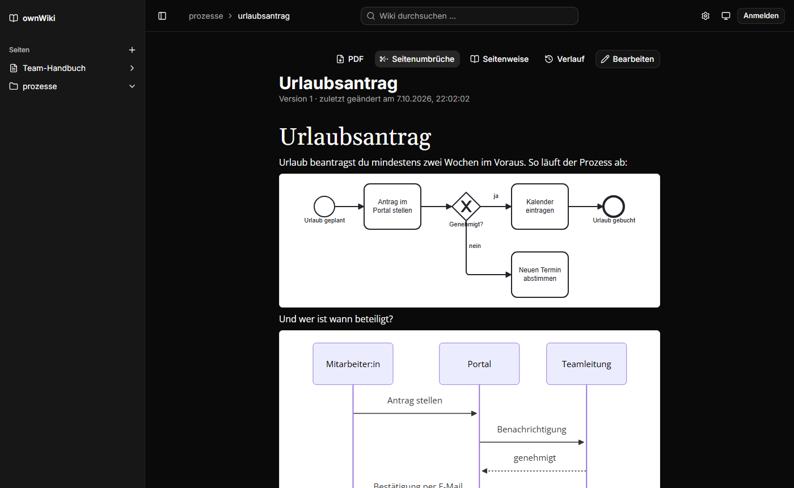

### Rechte pro Bereich

Admins legen unter **Verwaltung** (Schild-Symbol oben rechts) Gruppen an, z. B. „HR“, und vergeben Rechte: für einen Bereich – einen Seitenpfad mit allem darunter, oder das ganze Wiki – an alle, eine Gruppe oder eine einzelne Person, jeweils _kein Zugriff_, _lesen_ oder _bearbeiten_.

- Ohne Regel darf jede Person alles lesen und bearbeiten.
- Eine Regel auf `personal` gilt auch für `personal/kuendigung`; eine Regel auf einem Unterbereich geht für dieselbe Gruppe oder Person vor.
- Die Regel für eine Person geht vor der ihrer Gruppen (von mehreren Gruppen zählt die großzügigste), die einer Gruppe vor der für alle.
- Admins dürfen immer alles. Das erste Konto eines Wikis ist Admin; weitere ernennt man in der Verwaltung.

Was jemand nicht lesen darf, gibt es für ihn nicht: Die Seite fehlt in Seitenleiste, Suche, PDF-Export, Links und Backlinks, auch Dateien darauf sind nicht abrufbar. Das gilt genauso für KI-Assistenten – sie dürfen genau, was die Person darf, die sie verbunden hat. `AUTH_MODE` begrenzt weiterhin, was ohne Anmeldung möglich ist.

### KI-Anbindung (MCP)

ownWiki lässt sich als „Second Brain“ an KI-Assistenten wie ChatGPT oder Claude anbinden – über das [Model Context Protocol](https://modelcontextprotocol.io). Die KI kann dann im Wiki suchen, Seiten lesen, Bereiche und Tags auflisten und Backlinks abfragen (welche Seiten auf eine Seite verlinken) – und Seiten anlegen, ändern, taggen oder etwas an sie anhängen. Außerdem notiert sie auf Zuruf in der persönlichen Inbox („notier dir das“) und sortiert Notizen mit einem ins Wiki ein. Jede Änderung ist eine neue Version; im Verlauf steht, wer sie über welche KI gemacht hat (z. B. „Erika Muster über ChatGPT“). Löschen kann die KI nicht.

Die Adresse für den Assistenten ist `https://dein-wiki.example.org/mcp`. Angemeldet wird per **OAuth**: Jede Person verbindet den Assistenten einmal mit ihrem eigenen Wiki-Konto – Anmelden, dann „Erlauben“ – und der Assistent handelt danach als diese Person. So ist nachvollziehbar, wer was getan hat, und es gibt kein gemeinsames Passwort. Assistenten registrieren sich dabei selbst (Dynamic Client Registration). Unter **Einstellungen → KI-Verbindungen** sieht jede Person ihre verbundenen Assistenten und kann sie trennen – der Zugriff endet sofort.

Voraussetzung ist, dass `ORIGIN` gesetzt ist – ohne gibt es die Anbindung nicht.

- **ChatGPT Business/Enterprise:** Ein Admin schaltet in den Workspace-Einstellungen den Entwicklermodus ein, legt einen Connector mit der Adresse oben und Authentifizierung „OAuth“ an und veröffentlicht ihn für den Workspace. Danach verbindet sich jede Person beim ersten Benutzen selbst.
- **Claude Code und andere MCP-Clients:** die Adresse als HTTP-MCP-Server eintragen, z. B. `claude mcp add --transport http ownwiki https://dein-wiki.example.org/mcp`.

ChatGPT ruft das Wiki von OpenAIs Servern aus auf, nicht vom eigenen Rechner. Das Wiki muss dafür nicht öffentlich erreichbar sein: OpenAIs [Secure MCP Tunnel](https://github.com/openai/tunnel-client) baut aus dem eigenen Netz eine ausgehende Verbindung auf.

## Schnellstart mit Docker

```sh
cp .env.example .env
# In .env mindestens setzen:
#   BETTER_AUTH_SECRET – zufälliger Wert, z. B. aus: openssl rand -base64 32
#   ORIGIN            – die Adresse, unter der das Wiki erreichbar ist, z. B. http://localhost:3000
docker compose up -d
```

Das Wiki läuft dann auf Port 3000. Die Datenbank (SQLite) liegt im Docker-Volume `wikidata`; Migrationen laufen beim Start automatisch. Für PostgreSQL in `.env` `DATABASE_DIALECT=postgresql` und die passende `DATABASE_URL` setzen und mit `docker compose --profile postgresql up -d` starten.

**Semantische Suche auf eigener Hardware:** In `.env` zusätzlich

```sh
EMBEDDINGS_URL=http://ollama:11434/v1
EMBEDDINGS_MODEL=bge-m3
EMBEDDINGS_MIN_SCORE=0.5
```

setzen und mit `docker compose --profile ollama up -d` starten. Das startet [Ollama](https://ollama.com) als eigenen Container und lädt beim ersten Mal das Modell herunter (bge-m3, etwa 1,2 GB; versteht Deutsch gut). Eine Grafikkarte ist nicht nötig, das Modell braucht rund 2 GB Arbeitsspeicher. Sobald es da ist, erfasst das Wiki alle Seiten im Hintergrund. Gemessen auf einem Prozessor mit 12 Threads ohne Grafikkarte: eine Suche rund 30 ms, das Erfassen etwa 0,3 s pro Abschnitt – für 1.000 Seiten beim ersten Start also grob eine halbe Stunde, danach pro gespeicherter Seite ein, zwei Sekunden. Reicht die Hardware nicht, trägt man stattdessen einen Cloud-Dienst wie Azure OpenAI ein (siehe [Suche](#suche)) und startet ohne `--profile ollama`.

Das Image enthält Chromium für den PDF-Export.

Statt selbst zu bauen, kannst du auch das fertige Image aus der GitHub Container Registry nehmen – dafür in `compose.yaml` `build: .` durch `image: ghcr.io/sniphs98/ownwiki:latest` (oder eine feste Version wie `:1.2.0`) ersetzen.

## Konfiguration

| Variable                | Bedeutung                                                                                                                                                                                                        |
| ----------------------- | ---------------------------------------------------------------------------------------------------------------------------------------------------------------------------------------------------------------- |
| `DATABASE_DIALECT`      | `sqlite` (Standard) oder `postgresql`                                                                                                                                                                            |
| `DATABASE_URL`          | SQLite: Pfad zur Datei, z. B. `./data/wiki.db` · PostgreSQL: Verbindungs-URL                                                                                                                                     |
| `ORIGIN`                | Öffentliche Adresse des Wikis. Wird für Anmeldung, die KI-Anbindung und absolute Links im PDF verwendet.                                                                                                         |
| `BETTER_AUTH_SECRET`    | Geheimer Schlüssel für Sitzungen (mindestens 32 Zeichen)                                                                                                                                                         |
| `AUTH_MODE`             | Wer was darf, siehe unten. Standard: `read-only`                                                                                                                                                                 |
| `ALLOW_SIGNUP`          | Wer ein Konto anlegen darf, siehe unten. Standard: nur das erste Konto                                                                                                                                           |
| `PORT`                  | Port des Servers, Standard `3000`                                                                                                                                                                                |
| `ADDRESS_HEADER`        | Hinter einem Reverse-Proxy: Header mit der echten Client-IP, z. B. `X-Forwarded-For`                                                                                                                             |
| `BODY_SIZE_LIMIT`       | Größte Anfrage, die der Server annimmt. Im Docker-Image `11M`, damit Uploads bis 10 MB gehen                                                                                                                     |
| `EMBEDDINGS_URL`        | Adresse eines Embedding-Dienstes mit OpenAI-Schnittstelle, für die semantische Suche (siehe oben). Ohne: nur Volltextsuche                                                                                       |
| `EMBEDDINGS_MODEL`      | Name des Embedding-Modells, z. B. `text-embedding-3-small`                                                                                                                                                       |
| `EMBEDDINGS_API_KEY`    | API-Schlüssel des Dienstes, falls er einen braucht                                                                                                                                                               |
| `EMBEDDINGS_DIMENSIONS` | Optional: kürzere Vektoren anfordern, z. B. `512` bei `text-embedding-3-*` – spart Speicher                                                                                                                      |
| `EMBEDDINGS_MIN_SCORE`  | Ab welcher Ähnlichkeit (0–1) eine Seite als inhaltlicher Treffer zählt. Standard `0.3` (passt zu `text-embedding-3-*`); für `bge-m3` `0.5`. Andere Modelle: höher setzen, wenn zu viel Unpassendes gefunden wird |

**Zugriffsmodi (`AUTH_MODE`):**

- `disabled` – ohne Anmeldung: alle dürfen lesen und schreiben.
- `read-only` – alle dürfen lesen, Bearbeiten erfordert eine Anmeldung.
- `full` – ohne Anmeldung kein Zugriff (privates Wiki).

**Registrierung (`ALLOW_SIGNUP`):**

- nicht gesetzt (Standard) – nur das erste Konto kann sich registrieren, danach ist die Registrierung geschlossen.
- `true` – alle dürfen sich registrieren.
- `false` – niemand darf sich registrieren.

Bei `AUTH_MODE=full` sollte die Registrierung geschlossen bleiben, sonst kann sich jede Person selbst Zugang zum privaten Wiki verschaffen.

## Entwicklung

Voraussetzung: Node.js 24.

```sh
npm install
cp .env.example .env     # BETTER_AUTH_SECRET und ORIGIN=http://localhost:5173 setzen
npm run db:push          # Datenbankschema anlegen bzw. aktualisieren
npx playwright install chromium   # einmalig, für den PDF-Export
npm run dev
```

| Befehl                            | Zweck                                                                                                                  |
| --------------------------------- | ---------------------------------------------------------------------------------------------------------------------- |
| `npm run dev`                     | Entwicklungsserver auf http://localhost:5173                                                                           |
| `npm run check`                   | Typprüfung (svelte-check)                                                                                              |
| `npm run lint` / `npm run format` | Prettier und ESLint                                                                                                    |
| `npm run test:unit`               | Unit-Tests mit Vitest                                                                                                  |
| `npm run test:e2e`                | Ende-zu-Ende-Tests mit Playwright                                                                                      |
| `npm run build`                   | Produktions-Build (`node build` startet ihn)                                                                           |
| `npm run db:generate`             | Migration aus Schemaänderungen erzeugen (für SQLite und PostgreSQL jeweils mit passendem `DATABASE_DIALECT` ausführen) |

Die Ende-zu-Ende-Tests bauen die App und starten sie wie im Docker-Image (`node build`), mit einer eigenen, jedes Mal neu befüllten Datenbank unter `.data/e2e/` – die Entwicklungsdatenbank bleibt unberührt. Sie prüfen unter anderem, dass Web-Ansicht und PDF an denselben Stellen umbrechen, dass keine leeren Seiten entstehen und dass die Seitenumbruch-Linien mit dem echten PDF übereinstimmen.

Bei jedem Pull Request und jedem Push auf `main` laufen Lint, Typprüfung, Unit- und Ende-zu-Ende-Tests sowie der Docker-Build in GitHub Actions (`.github/workflows/ci.yml`).

### Release erstellen

Jeder Merge nach `main` wird automatisch veröffentlicht (`.github/workflows/auto-release.yml`). Das Label am Pull Request bestimmt, wie die Version gegenüber dem letzten Tag steigt:

| Label am PR    | Version                                      |
| -------------- | -------------------------------------------- |
| _keins_        | Patch: `1.2.3` → `1.2.4`                     |
| `feature`      | Minor: `1.2.3` → `1.3.0`                     |
| `breaking`     | Major: `1.2.3` → `2.0.0`                     |
| `kein-release` | kein Release (z. B. nur Doku, Tests oder CI) |

Der Release lässt erst die komplette CI laufen, baut dann das Docker-Image und legt es als `ghcr.io/sniphs98/ownwiki` mit den Tags `1.2.0`, `1.2` und `latest` ab. Zum Schluss legt er den Versions-Tag und einen GitHub-Release mit automatisch erzeugten Release-Notes an.

Von Hand geht es weiterhin mit einem Versions-Tag (`.github/workflows/release.yml`):

```sh
git tag v1.2.0
git push origin v1.2.0
```

Tags mit Zusatz wie `v1.2.0-rc.1` werden als Pre-Release veröffentlicht und verschieben `latest` nicht.

### Aufbau

- **SvelteKit** (Svelte 5) mit **shadcn-svelte** und Tailwind CSS
- **Drizzle ORM** für SQLite und PostgreSQL (`src/lib/server/db`, Repositories in `src/lib/server/repo`)
- **Better Auth** für Konten; die Zugriffsmodi setzt `src/hooks.server.ts` durch
- **Milkdown Crepe** als Editor (`src/lib/components/wiki/markdown-editor.svelte`)
- **PDF-Export**: Die Route `/print/…` rendert die Seiten mit dem echten Editor, [pagedjs](https://pagedjs.org) teilt sie in A4-Seiten auf, und ein Chromium (Playwright) auf dem Server druckt das Ergebnis als PDF (`src/lib/server/pdf`, `src/lib/paginate.ts`). Die Seitenumbruch-Vorschau führt dieselbe Aufteilung unsichtbar im Browser aus (`src/lib/page-breaks.ts`).
- Dateien liegen als BLOB in der Datenbank und werden über `/api/files/[id]` ausgeliefert.
- **Suche** (`src/lib/server/search`): Volltext in der Datenbank, dazu optional semantisch – Seiten werden in Abschnitte zerlegt (`semantic/chunks.ts`), im Hintergrund eingebettet, im Arbeitsspeicher verglichen und mit den Volltext-Treffern per Reciprocal Rank Fusion gemischt.
- **MCP-Server** für KI-Assistenten unter `/mcp` (`src/lib/server/mcp`, offizielles MCP-SDK, zustandslos über Streamable HTTP), geschützt per OAuth – Better Auth ist dafür mit dem `mcp()`-Plugin zugleich OAuth-Server (`src/lib/server/auth.ts`, Zustimmungsseite unter `/consent`).

## Noch nicht umgesetzt

- Speicherung von Dateien in S3-kompatiblem Speicher (z. B. MinIO) statt in der Datenbank
